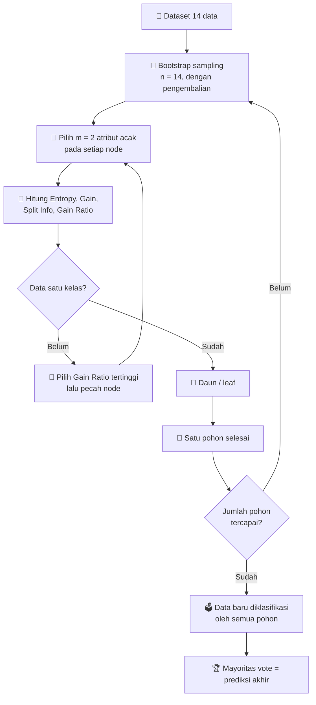

<div align="center">

# 🌳 Simulasi Random Forest

### Prediksi Kelulusan Tepat Waktu Mahasiswa

*Simulasi interaktif algoritma **Random Forest** (Gain Ratio) yang menampilkan perhitungan manual langkah demi langkah, dari bootstrap sampling sampai mayoritas vote.*

<br>


<br>

[🚀 **Buka Web Simulasi**](https://simulasi-random-forest-kelulusan.vercel.app/) · [🎬 **Video Tutorial**](ISI_LINK_YOUTUBE) · 

</div>

---

## 📑 Daftar Isi

- [Tentang Project](#-tentang-project)
- [Fitur Utama](#-fitur-utama)
- [Studi Kasus dan Dataset](#-studi-kasus-dan-dataset)
- [Cara Kerja Algoritma](#-cara-kerja-algoritma)
- [Rumus yang Digunakan](#-rumus-yang-digunakan)
- [Hasil Simulasi](#-hasil-simulasi)
- [Cara Menggunakan Web](#-cara-menggunakan-web)
- [Menjalankan Secara Lokal](#-menjalankan-secara-lokal)
- [Deploy ke Vercel](#-deploy-ke-vercel)
- [Struktur Project](#-struktur-project)
- [Dokumen Tugas](#-dokumen-tugas)
- [Identitas](#-identitas)

---

## 🎯 Tentang Project

Project ini dibuat untuk **Tugas 1 Machine Learning**. Tujuannya adalah memahami algoritma **Random Forest** dengan cara menghitungnya secara manual, lalu membuat **web simulasi** yang menjalankan perhitungan yang sama secara otomatis.

Studi kasus yang dipakai adalah **prediksi kelulusan tepat waktu mahasiswa**: apakah seorang mahasiswa diperkirakan lulus tepat waktu berdasarkan IPK, tingkat kehadiran, keaktifan organisasi, dan status kerja sambilan.

> 💡 Seluruh perhitungan dilakukan langsung di browser. Tidak ada server, database, maupun instalasi tambahan.

---

## ✨ Fitur Utama

| | Fitur | Keterangan |
|---|---|---|
| 🎲 | **Bootstrap Sampling** | Pengambilan data acak dengan pengembalian untuk setiap pohon |
| 🧮 | **Entropy, Gain, Split Info, Gain Ratio** | Tabel perhitungan lengkap pada setiap node, bisa dibuka satu per satu |
| 🌲 | **Visualisasi Pohon Keputusan** | Pohon digambar otomatis untuk setiap pohon di dalam forest |
| 🗳️ | **Mayoritas Vote** | Prediksi akhir diambil dari suara terbanyak seluruh pohon |
| 🧭 | **Jalur Prediksi** | Jalur keputusan pada tiap pohon ditandai warna oranye |
| 📂 | **Data Sendiri** | Tempel data CSV kategorikal sendiri, kolom terakhir sebagai label |
| ⚙️ | **Parameter Fleksibel** | Atur jumlah pohon, jumlah atribut acak (m), dan seed |
| 📘 | **Mode Laporan** | Pengacakan yang sama dengan laporan, jadi hasilnya identik dengan perhitungan manual |
| 🌗 | **Mode Terang dan Gelap** | Tampilan menyesuaikan pengaturan perangkat |
| 📱 | **Responsif** | Nyaman dibuka di laptop maupun ponsel |

---

## 📊 Studi Kasus dan Dataset

**Atribut dan nilainya**

| Atribut | Nilai |
|---|---|
| `IPK` | Tinggi, Sedang, Rendah |
| `Kehadiran` | Baik, Cukup, Kurang |
| `Organisasi` | Ya, Tidak (aktif organisasi) |
| `Kerja` | Ya, Tidak (kerja sambilan) |
| **Label:** `Lulus Tepat Waktu` | Ya, Tidak |

**Dataset (14 data: 9 Ya dan 5 Tidak)**

| No | IPK | Kehadiran | Organisasi | Kerja | Lulus Tepat Waktu |
|:-:|:-:|:-:|:-:|:-:|:-:|
| 1 | Rendah | Kurang | Tidak | Ya | Tidak |
| 2 | Rendah | Kurang | Tidak | Tidak | Tidak |
| 3 | Sedang | Baik | Tidak | Ya | Ya |
| 4 | Tinggi | Cukup | Tidak | Ya | Ya |
| 5 | Tinggi | Baik | Ya | Ya | Ya |
| 6 | Tinggi | Kurang | Ya | Tidak | Tidak |
| 7 | Sedang | Baik | Ya | Tidak | Ya |
| 8 | Rendah | Cukup | Tidak | Ya | Tidak |
| 9 | Rendah | Baik | Ya | Ya | Ya |
| 10 | Tinggi | Cukup | Ya | Ya | Ya |
| 11 | Rendah | Cukup | Ya | Tidak | Ya |
| 12 | Sedang | Cukup | Tidak | Tidak | Ya |
| 13 | Sedang | Baik | Ya | Ya | Ya |
| 14 | Tinggi | Kurang | Tidak | Tidak | Tidak |

> ℹ️ Data ini adalah data ilustrasi yang dibuat untuk keperluan simulasi dan perhitungan manual, bukan data resmi sebuah institusi.

---

## 🧠 Cara Kerja Algoritma



1. **Bootstrap sampling**: ambil 14 data secara acak dengan pengembalian untuk setiap pohon.
2. **Pilih atribut acak**: pada setiap node, pilih `m = 2` atribut secara acak sebagai kandidat.
3. **Hitung kriteria**: hitung *Entropy*, *Gain*, *Split Info*, dan *Gain Ratio* tiap kandidat.
4. **Pecah node**: pilih atribut dengan *Gain Ratio* tertinggi, lalu ulangi sampai seluruh data di cabang bernilai satu kelas.
5. **Ulangi** untuk membentuk pohon kedua dan ketiga.
6. **Majority vote**: data baru diklasifikasi tiap pohon, hasil terbanyak menjadi prediksi akhir.

---

## 📐 Rumus yang Digunakan

**Entropy**

$$Entropy(S) = \sum_{i=1}^{n} -p_i \cdot \log_2(p_i)$$

**Information Gain**

$$Gain(S,A) = Entropy(S) - \sum_{i=1}^{n} \frac{|S_i|}{|S|} \cdot Entropy(S_i)$$

**Split Info**

$$SplitInfo(S,A) = -\sum_{i=1}^{c} \frac{|S_i|}{|S|} \cdot \log_2\frac{|S_i|}{|S|}$$

**Gain Ratio**

$$GainRatio(S,A) = \frac{Gain(S,A)}{SplitInfo(S,A)}$$

---

## 🏁 Hasil Simulasi

Konfigurasi laporan: **3 pohon**, **m = 2**, entropy total data = **0,940286**.

| Pohon | Atribut Root | Gain Ratio Root | Struktur Singkat |
|:-:|:-:|:-:|---|
| 1 | `Kerja` | 0,136879 | Kerja → Kehadiran / Organisasi → IPK |
| 2 | `Organisasi` | 0,508726 | Organisasi → Kehadiran |
| 3 | `Kehadiran` | 0,489733 | Kehadiran saja |

**Contoh prediksi**

| Atribut | Nilai |
|---|---|
| IPK | Tinggi |
| Kehadiran | Cukup |
| Organisasi | Ya |
| Kerja | Tidak |

| Pohon | Hasil |
|:-:|:-:|
| 1 | Ya |
| 2 | Ya |
| 3 | Ya |

### 🏆 Mayoritas vote: **Ya**, jadi mahasiswa diprediksi **lulus tepat waktu**

---

## 🖥️ Cara Menggunakan Web

1. Buka web simulasi, dataset contoh sudah terisi otomatis.
2. Atur **jumlah pohon**, **m**, dan **seed**, atau biarkan default.
3. Biarkan **Pakai pengacakan laporan** tercentang agar hasilnya sama dengan perhitungan manual di laporan.
4. Klik **Jalankan Simulasi**.
5. Buka bagian **Langkah per node** untuk melihat tabel Entropy, Gain, Split Info, dan Gain Ratio.
6. Lihat **pohon keputusan** yang terbentuk.
7. Pilih nilai atribut pada bagian **Prediksi Data Baru**, lalu klik **Prediksi** untuk melihat hasil tiap pohon dan mayoritas vote.

**Memakai data sendiri**

Tempel data pada kotak CSV dengan format berikut. Baris pertama adalah nama kolom, dan kolom terakhir adalah label.

```csv
IPK,Kehadiran,Organisasi,Kerja,Lulus Tepat Waktu
Tinggi,Baik,Ya,Tidak,Ya
Rendah,Kurang,Tidak,Ya,Tidak
```

> Semua atribut harus bernilai kategorikal (teks). Data angka perlu dikelompokkan terlebih dahulu, misalnya menjadi Tinggi, Sedang, Rendah.

---

## 💻 Menjalankan Secara Lokal

Tidak perlu instalasi apa pun.

```bash
# 1. Clone repository
git clone https://github.com/USERNAME/random-forest-kelulusan-tepat-waktu.git

# 2. Masuk ke folder
cd random-forest-kelulusan-tepat-waktu

# 3. Buka index.html di browser (klik dua kali),
#    atau pakai ekstensi Live Server di VS Code
```

---

## ☁️ Deploy ke Vercel

1. Upload project ke GitHub.
2. Buka [vercel.com](https://vercel.com) dan masuk dengan akun GitHub.
3. Klik **Add New → Project**, pilih repository ini, lalu **Import**.
4. Biarkan **Framework Preset** sebagai *Other*, kosongkan Build Command dan Output Directory.
5. Klik **Deploy**.

---

## 📁 Struktur Project

```text
random-forest-kelulusan-tepat-waktu/
├── index.html    # Web simulasi (HTML, CSS, dan JavaScript dalam satu file)
└── README.md     # Dokumentasi project
```

---

## 📄 Dokumen Tugas

| Dokumen | Tautan |
|---|---|
| 🌐 Web simulasi | [ISI_LINK_VERCEL](https://simulasi-random-forest-kelulusan.vercel.app/) |
| 🎬 Video tutorial | [ISI_LINK_YOUTUBE](ISI_LINK_YOUTUBE) |

---

## 👤 Identitas

<div align="center">

| | |
|---|---|
| **Nama** | Soni Moch Leviansyah |
| **NIM** | 301240030 |
| **Program Studi** | Teknik Informatika |
| **Fakultas** | Teknologi Informasi |
| **Universitas** | Universitas Bale Bandung |
| **Dosen Pembimbing** | Mochamad Bayu Anggara, S.Kom., M.Kom. |
| **Tahun** | 2026 |

<br>

⭐ *Jika project ini bermanfaat, jangan lupa beri bintang.*

</div>
